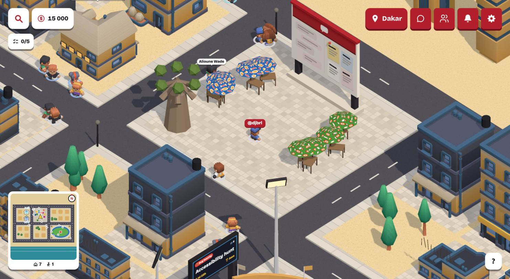
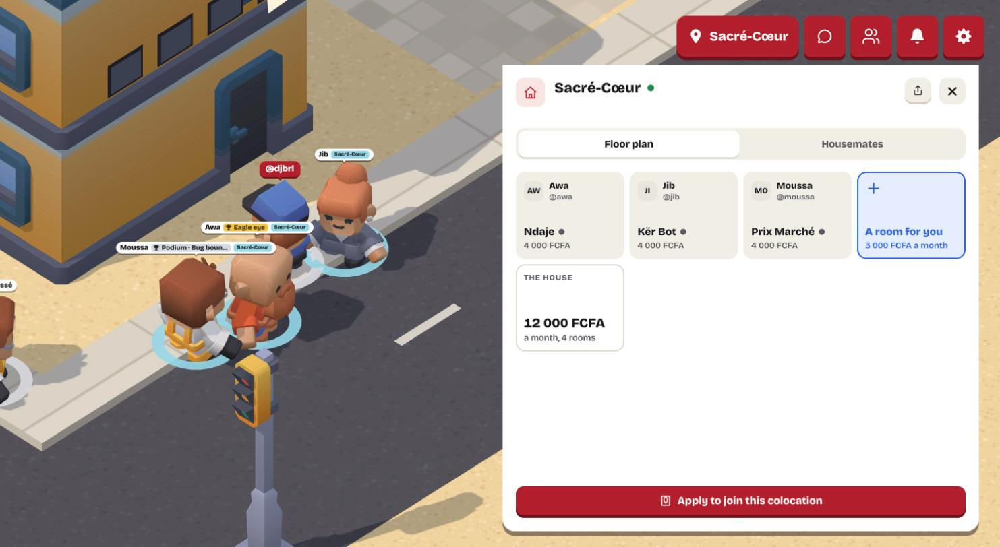
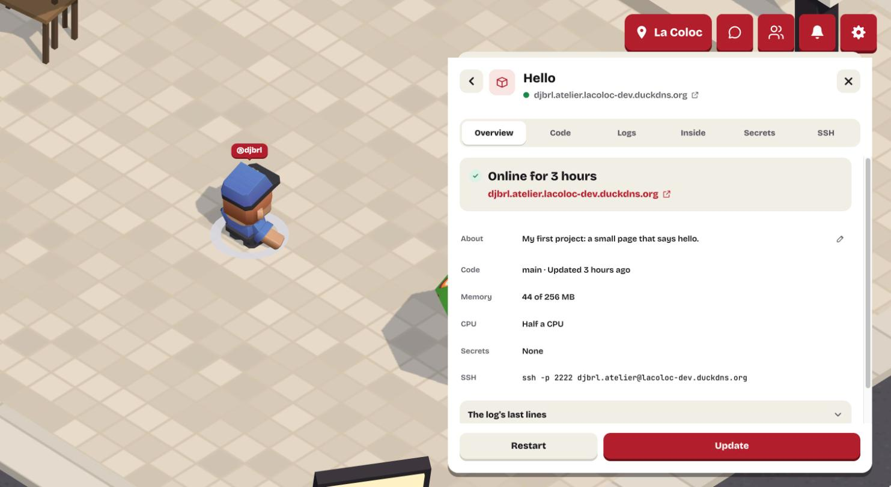
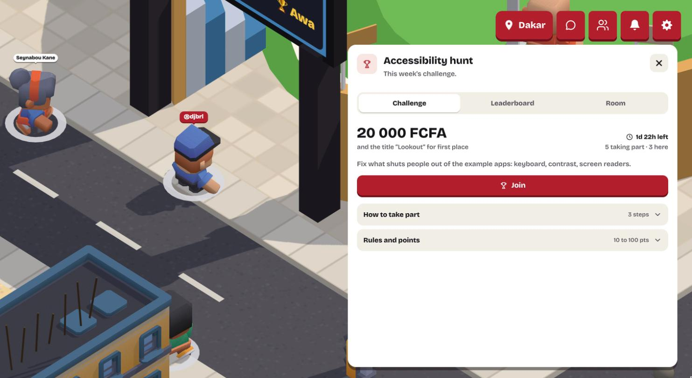
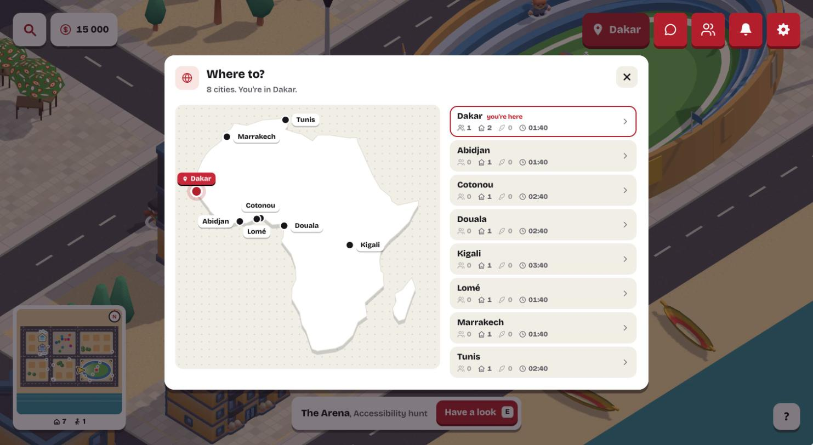

# La Coloc

**A city of dev houses.** La Coloc is a walkable 3D city where developers rent rooms in shared servers, called houses.
Your room runs your GitHub project online, built and served by a small program on the house's server. Flatmates split
the server bill, and each code review you do for them pays part of your rent.



| | |
|---|---|
|  |  |
| **A house:** its rooms, who lives there, and the monthly bill. | **A room:** a project online, with its address and SSH. |
|  |  |
| **The Arena:** a weekly challenge per city, with a prize. | **Travel:** eight cities, one map. |

## What you can do in it

It runs at https://lacoloc-dev.duckdns.org, on a Systalink Datacloud server set up by [`deploy/`](deploy/).

- **Walk the city** in eight African cities, each with its own look, and travel between them on a map of Africa.
  Settings can show the same city as a Dashboard, with no 3D.
- **Get your first home** in a short quest: take a room, put a starter page or one of your repos online, share the link.
- **Move into a house** by applying for a free room (the flatmates vote; a *knock* in the code), by accepting an
  invitation, or by renting a server for a house of your own.
- **Push to go live:** merge a pull request and your room rebuilds with no downtime; open one and you get a preview.
- **Use your room as a small server:** SSH into it, see what runs inside, and keep files in `/home/your-room`.
- **Review your flatmates' code:** La Coloc picks the reviewer in turn, and each review earns you 500 FCFA of credit, which pays your rent.
- **Pay rent in credit:** your share of the bill (by room size and CPU used) is taken from your in-city credit each
  month. Buy more with PayDunya in test mode (mobile money or card); no real money moves.
- **Play the Arena:** a weekly challenge per city, answered with pull requests on GitHub, with points, a podium and a
  prize in credit ([docs/arena.md](docs/arena.md)).
- **Get news under the bell:** invitations, applications to your house and their answers, friend requests, rent, replies
  and @mentions, and Arena results.
- **Talk:** direct messages, a public room and a board per city (looking for a house, flatmates, a project), and
  your house's channel, in one card over the city. Add friends and see who's online; mute, block or report anyone.
- **Play in English or French.** If the database goes down, the city stays up and heals by itself.

## Quick start

Needs Node 22.9+ and Docker Desktop. The full guide, with what you should see at each step, is [docs/dev.md](docs/dev.md).

```bash
npm ci && npm run build
cp dev/.env.example dev/.env.local    # then add the two lines from docs/dev.md, step 2
npm run dev:proxy && npm run dev:seed # Traefik and Postgres in Docker, then the example city
npm run up                            # the API, both caretakers and this laptop's own keys
npm run dev:web                       # open http://localhost:5175/login
```

`npm run up` also shares the city on Vercel through a tunnel when `cloudflared` and the Vercel CLI are installed
(`COLOC_SHARE=0` keeps it on your laptop), with the dev login turned off
([how](docs/dev.md#sharing-the-city-from-a-laptop)). To put the whole city on a fresh Ubuntu 24.04 server, as the
live one is, run `deploy/push.sh <ip>` ([how](docs/dev.md#putting-the-city-on-a-real-server)).

## Read next

- [Handoff](HANDOFF.md): where things stand and what to do next. Start here if you are picking the project up.
- [How it works](docs/how-it-works.md): the product's ideas in plain words.
- [Architecture](docs/architecture.md): the pieces, and how a push becomes a live room.
- [Glossary](docs/glossary.md): every word, one sentence each.
- [SSH into a room](docs/ssh-walkthrough.md): the whole path of a shell, file by file.
- [Contributing](CONTRIBUTING.md) and [TODO](TODO.md): how we work, and what's left.
- [All the docs](docs/README.md).

Built for the CADEV 2026 contest, *an African exchange platform built for devs by devs* ([rules](docs/contest-rules.md)).

Every dependency and asset is under a permissive licence or CC0 ([docs/licences.md](docs/licences.md)). The rules of
3 Nov no longer say what a winner gives the organiser, Systalink.
