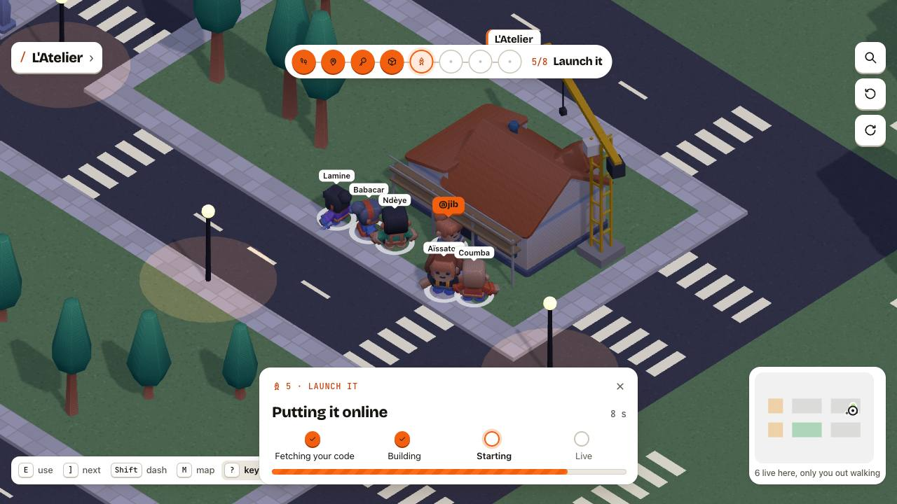

# La Coloc

**A city of dev houses.** La Coloc is a walkable 3D city where developers rent rooms in shared servers, called houses.
Your room runs your GitHub project online, built and served by a small program on the house's server. Flatmates split
the server bill, and each code review you do for them pays part of your rent.



## What you can do in it

- **Walk the city** in eight African cities, each with its own look, and travel between them on a map of Africa.
- **Get your first home** in a short quest: take a room, put a starter page or one of your repos online, share the link.
- **Move into a house** by knocking on a free room (the flatmates vote) or by accepting an invitation.
- **Push to go live:** merge a pull request and your room rebuilds with no downtime; open one and you get a preview.
- **Review your flatmates' code:** La Coloc picks the reviewer in turn, and each review takes 500 FCFA off your rent.
- **Share the bill** by room size and CPU used, and follow the house's tontine turn. (Paying is a mock for now.)
- **Get news under the bell:** invitations, knocks on your house, answers to your knock.
- **Talk:** direct messages, a public room and a board per city (looking for a house, flatmates, a project), and
  your house's channel, in one card over the city.
- **Play in English or French.** If the database goes down, the city stays up and heals by itself.

## Quick start

Needs Node 22.9+ and Docker Desktop. The full guide, with what you should see at each step, is [docs/dev.md](docs/dev.md).

```bash
npm ci && npm run build
cp dev/.env.example dev/.env.local    # then add the two lines from docs/dev.md, step 2
npm run dev:proxy && npm run dev:seed # Traefik and Postgres in Docker, then the example city
npm run start -w @coloc/api           # the API, then the two caretakers (docs/dev.md, step 6)
npm run dev:web                       # open http://localhost:5175/login
```

To let someone try it from your laptop: `npm run share` ([how](docs/dev.md#sharing-the-city-from-a-laptop)).

## Read next

- [Handoff](HANDOFF.md): where things stand and what to do next. Start here if you are picking the project up.
- [How it works](docs/how-it-works.md): the product's ideas in plain words.
- [Architecture](docs/architecture.md): the pieces, and how a push becomes a live room.
- [Glossary](docs/glossary.md): every word, one sentence each.
- [Contributing](CONTRIBUTING.md) and [TODO](TODO.md): how we work, and what's left.
- [All the docs](docs/README.md).

Built for the CADEV 2026 contest, *an African exchange platform built for devs by devs* ([rules](docs/contest-rules.md)).

Every dependency and asset is under a permissive licence or CC0 ([docs/licences.md](docs/licences.md)). If the project
wins, its rights go to the organiser, Systalink (rules, Art. 8).
